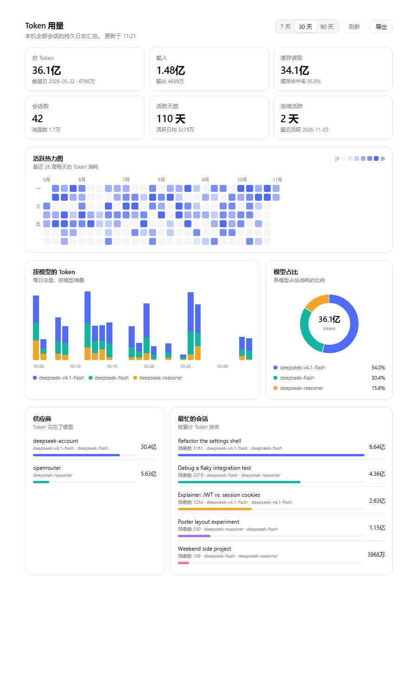

# dsh-usage-panel

A DeepSeek Harness (`dsh`) plugin that adds a **Token usage** page: KPI cards, a 26-week activity
heatmap, a per-model stacked bar chart and a model donut — all folded from the durable Session logs
already on your machine.

It has two entry points that render the same page:

- a **row in the left sidebar**, which opens the page in the main column (no Settings dialog), and
- **Settings → 用量 / Usage**, beside the other settings pages.



*The screenshots use the synthetic dataset in `dev/sample-summary.json`; reproduce them with
`node dev/preview.mjs zh --sample`. No real Session data is included in this repository.*

## What it shows

| Block | Meaning |
|---|---|
| KPI cards | Total tokens, input/output, cache read + hit rate, Sessions, active days and the current streak |
| Activity heatmap | Token volume per local day over the last 26 weeks, with a hover breakdown |
| Tokens by model | Daily total stacked by model for the last 7 / 30 / 90 days |
| Model share | Each model's share of all tokens |
| Providers | Tokens split by the provider that served each request |
| Busiest Sessions | Top Sessions by accumulated tokens, with their message count and models |

The page follows the harness language (`zh` / `en`) and theme (light and dark) automatically,
because it renders with the settings shell's own design tokens.

**Export** writes the current range's daily series or the per-model table as CSV, or the whole
summary as JSON — all generated in the page, nothing is uploaded.

## How it works

Two halves, one package:

- **Host** (`lib/index.js`) — a Cordis plugin that registers one route,
  `GET /usage-panel/api/summary?days=30[&refresh=1]`, on the harness web server. It scans
  `$DSH_HOME/sessions/**/session.v*.jsonl[.zstd]`, decodes the concatenated Zstandard frames,
  folds `assistant/message` usage records by day, model, provider and Session, and answers JSON.
  Per-file results are cached on the artifact's size/mtime and resumed from the last decoded
  frame boundary, so a warm request is served from memory and an appended batch costs only its
  own bytes.
- **Browser** (`lib/client.js`) — a client-module bundle (`window.__ModuleLoader__.load`) that
  registers a `settings.section` page and fetches the summary. It uses only the platform `react`
  module and inline theme tokens, so nothing else has to be composed.

Nothing here is model-facing: no tool, no prompt, no provider request.

## Install

A `dsh` profile composes its tree from bundles. This package declares
`dsh.bundle.patch = ./cordis.patch.yml`, so installing it as a profile bundle is enough.

```powershell
# 1. make the package available to the profile (a link is fine for local development)
dsh plugin --profile desktop add link:E:/path/to/dsh-usage-panel

# 2. select the bundle — package.json, in dsh.profile.bundles
#    "@deepseek-ai/dsh-base",
#    "@deepseek-ai/dsh-web-app",
#    "dsh-usage-panel"
```

With HMR enabled the running composition picks the bundle up immediately; otherwise restart the
harness. Then open **Settings → 用量 / Usage**.

If you would rather not edit the profile by hand, install through the Web sidebar's **Plugins**
page or the `plugin_manager` tool, which maintain `dsh.profile.bundles` for you.

## Troubleshooting

**The sidebar row or Settings page disappears after a config reload.** The bundle was skipped at
composition time. Check the manifest encoding first — `package.json` must be UTF-8 **without a
BOM**, otherwise `JSON.parse` throws and DSH drops the whole bundle. You can compose a profile
throwaway copy offline and look for the warning:

```powershell
Copy-Item ~/.dsh/profiles/desktop ~/.dsh/profiles/desktop-check -Recurse
dsh --profile desktop-check --dump-config | Select-String "skipping profile bundle"
Remove-Item ~/.dsh/profiles/desktop-check -Recurse
```

A healthy dump contains `- id: usage-panel`. The `.editorconfig` in this repo pins the encoding so
editors do not reintroduce the BOM.

## Verify the host route

```powershell
curl.exe "http://127.0.0.1:60341/usage-panel/api/summary?days=30"
```

It answers `{"ok":true,...}` with the folded summary. Requests with `?refresh=1` bypass the
20-second cache.

## Develop

`dev/preview.mjs` renders the real `lib/client.js` against the live route with a small
React-compatible runtime and the harness's own light-theme tokens, then optionally screenshots it —
handy when you are iterating on the page without reloading the GUI:

```powershell
node dev/preview.mjs zh --shot assets/preview-zh.png
node dev/preview.mjs en

# render the synthetic dataset instead of a live host (what the screenshots use)
node dev/preview.mjs zh --sample --shot assets/preview-zh.png
node dev/preview.mjs en --sample

# render the main-column page instead of the Settings section
node dev/preview.mjs zh --sample --panel
```

Without `--sample` it calls a running host, so it never touches the repository's assets unless you
ask it to.

Set `DSH_ORIGIN` when the host listens somewhere else. `dev/tokens.json` holds the resolved
`--dsw-alias-*` values used by the preview page.

## Limits

- **Local sessions only.** The fold reads this machine's `$DSH_HOME/sessions`; it never calls a
  provider, so it cannot see usage from another install.
- **Tokens, not money.** Prices change and differ per provider, so no cost figure is derived.
- **Usage-bearing events only.** Sessions written before provider usage reporting existed count
  their messages but contribute zero tokens.
- **Route has no authentication.** Like every other non-`/api` web-server route it relies on the
  loopback bind; it exposes local token totals to whatever can reach the port.

## Layout

```
dsh-usage-panel/
├─ package.json          dsh.manifestVersion / dsh.bundle / dsh.client
├─ cordis.patch.yml      the bundle: one insert naming this package
├─ lib/index.js          host: log scan, fold, HTTP route
├─ lib/client.js         browser: settings.section page
├─ dev/preview.mjs       offline render + screenshot harness
├─ dev/tokens.json       resolved theme tokens for the preview
└─ assets/               preview screenshots
```

MIT licensed.