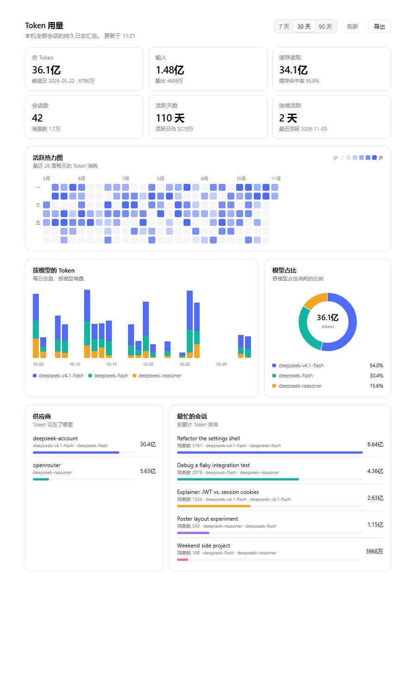

# dsh-usage-panel

给 DeepSeek Harness（`dsh`）加一个 **Token 用量** 设置页：KPI 卡片、26 周活跃热力图、按模型堆叠的
柱状图、模型环形图 —— 数据全部来自本机已有的会话持久日志。



*截图使用 `dev/sample-summary.json` 里的合成数据；用 `node dev/preview.mjs zh --sample` 可复现。
仓库里不含任何真实会话数据。*

## 页面内容

| 区块 | 含义 |
|---|---|
| KPI 卡片 | 总 Token、输入/输出、缓存读取与命中率、会话数、活跃天数、连续活跃 |
| 活跃热力图 | 最近 26 周每天的 Token 消耗，悬停查看当日明细 |
| 按模型的 Token | 最近 7 / 30 / 90 天的每日总量，按模型堆叠 |
| 模型占比 | 各模型占总消耗的比例 |
| 供应商 | 按实际承接请求的供应商拆分 |
| 最忙的会话 | 累计 Token 最高的会话，附消息数与使用的模型 |

页面使用设置面板自己的设计 Token，因此自动跟随 Harness 的语言（`zh` / `en`）与明暗主题。

**导出** 可以写出当前区间的每日序列、按模型的表格（CSV），或完整汇总（JSON）——全部在页面内生成，
不上传任何数据。

## 实现

一个包、两个半边：

- **Host**（`lib/index.js`）—— Cordis 插件，在 Web 服务器上注册一条路由
  `GET /usage-panel/api/summary?days=30[&refresh=1]`。它扫描
  `$DSH_HOME/sessions/**/session.v*.jsonl[.zstd]`，解码串接的 Zstandard 帧，把
  `assistant/message` 里的 usage 按天、模型、供应商、会话折叠成 JSON。
  每个文件按大小/mtime 缓存，并记住最后一个完整帧的字节位置：热请求直接走内存，追加写入的
  批次只解码新增的字节。
- **Browser**（`lib/client.js`）—— client-module 包（`window.__ModuleLoader__.load`），注册一个
  `settings.section` 页面并拉取汇总。只依赖平台内置的 `react` 模块和主题 Token，不需要组合其它插件。

不含任何面向模型的内容：没有工具、没有提示词、不发模型请求。

## 安装

profile 的插件树由 bundle 组合而成。本包声明了 `dsh.bundle.patch = ./cordis.patch.yml`，
所以只要把它作为 profile 的 bundle 装进去即可。

```powershell
# 1. 让 profile 能解析到这个包（本地开发用 link 即可）
dsh plugin --profile desktop add link:E:/path/to/dsh-usage-panel

# 2. 选中这个 bundle —— profile 的 package.json：
#    "@deepseek-ai/dsh-base",
#    "@deepseek-ai/dsh-web-app",
#    "dsh-usage-panel"
```

开启 HMR 时运行中的组合会立刻生效，否则重启 Harness。之后打开 **设置 → 用量**。

不想手改 profile 的话，也可以用 Web 侧栏的 **插件** 页面或 `plugin_manager` 工具安装，
它们会自行维护 `dsh.profile.bundles`。

## 验证宿主路由

```powershell
curl.exe "http://127.0.0.1:60341/usage-panel/api/summary?days=30"
```

返回 `{"ok":true,...}` 的汇总；带 `?refresh=1` 会跳过 20 秒缓存。

## 开发

`dev/preview.mjs` 用一个小型 React 兼容运行时把真正的 `lib/client.js` 渲染到实时数据上，
并套用 Harness 自己的亮色主题 Token，需要时顺带截图 —— 改页面时不用反复刷新 GUI：

```powershell
node dev/preview.mjs zh --shot assets/preview-zh.png
node dev/preview.mjs en

# 用合成数据渲染（截图就是这么生成的）
node dev/preview.mjs zh --sample --shot assets/preview-zh.png
node dev/preview.mjs en --sample
```

不带 `--sample` 时会去调用正在运行的宿主；`--sample` 只读 `dev/sample-summary.json`，不碰真实日志。

宿主不在默认地址时用 `DSH_ORIGIN` 指定。`dev/tokens.json` 是预览页用到的 `--dsw-alias-*`
解析结果。

## 限制

- **只看本机会话。** 折叠的是本机 `$DSH_HOME/sessions`，不调用供应商接口，看不到其它安装的用量。
- **只有 Token，没有费用。** 价格会变且各供应商不同，所以不推算金额。
- **只统计带 usage 的事件。** 早于供应商上报 usage 的会话会计入消息数，但 Token 记 0。
- **路由没有鉴权。** 与其它非 `/api` 的 Web 路由一致，依赖回环绑定；能访问该端口的人就能读到本机 Token 汇总。

## 结构

```
dsh-usage-panel/
├─ package.json          dsh.manifestVersion / dsh.bundle / dsh.client
├─ cordis.patch.yml      bundle：一条 insert，指向本包
├─ lib/index.js          宿主：日志扫描、聚合、HTTP 路由
├─ lib/client.js         浏览器：settings.section 页面
├─ dev/preview.mjs       离线渲染 + 截图工具
├─ dev/tokens.json       预览用的主题 Token
└─ assets/               预览截图
```

MIT License.